# Zihang Zhan · Fl0at9973

Hi there 👋 · 你好呀 🌩🐒🦆 · Здравствуйте 🍞 · こんにちは！🐕

Build broadens · Curve matters

  <a href="https://github.com/soMewheRetoFloat">GitHub</a> ·
  <a href="mailto:zihangzhan2003@gmail.com">Email</a>

### 👋 About Me

* 💻 Graduated as B.E of Computer Science and Technology and pursuing my M.E. of Electronic Information in Tsinghua University.
* 🧐 Investigating in Embodied Intelligence.

### 📊 WakaTime

<!-- WAKATIME:START -->
**Last 7 Days, Including Today**

🕑 Time Zone: Asia/Tokyo

**💬 Programming Languages**

| Name | Time | Share |
| --- | ---: | ---: |
| Other | 14 hrs 39 mins 7 secs | 49.69% |
| Python | 5 hrs 31 mins 52 secs | 18.76% |
| Markdown | 4 hrs 36 mins 31 secs | 15.63% |
| JavaScript | 1 hrs 8 mins 43 secs | 3.88% |
| Rust | 56 mins 52 secs | 3.21% |

**🔥 Editors**

| Name | Time | Share |
| --- | ---: | ---: |
| Codex Vscode | 14 hrs 29 mins 47 secs | 49.16% |
| Antigravity CLI | 7 hrs 52 mins 33 secs | 26.71% |
| DeepSeekHarness | 4 hrs 16 mins 48 secs | 14.51% |
| ChatGPT | 57 mins 13 secs | 3.23% |
| Claude Code | 37 mins 6 secs | 2.10% |

**💻 Operating Systems**

| Name | Time | Share |
| --- | ---: | ---: |
| Mac | 29 hrs 29 mins 21 secs | 100.00% |

Range: 2026-10-31 → 2026-11-06

Last 7 days total: 29 hrs 29 mins 21 secs

Last synced: 2026-11-06 08:38 Asia/Tokyo
<!-- WAKATIME:END -->

### 🧰 Tech Stack

  

### ✉️ Contact

