# Zihang Zhan · Fl0at9973

Hi there 👋 · 你好呀 🌩🐒🦆 · Здравствуйте 🍞 · こんにちは！🐕

Build broadens · Curve matters

  <a href="https://github.com/soMewheRetoFloat">GitHub</a> ·
  <a href="mailto:zihangzhan2003@gmail.com">Email</a>

### 👋 About Me

* 💻 Graduated as B.E of Computer Science and Technology and pursuing my M.E. of Electronic Information in Tsinghua University.
* 🧐 Investigating in Embodied Intelligence.

### 📊 WakaTime

<!-- WAKATIME:START -->
**Last 7 Days, Including Today**

🕑 Time Zone: Asia/Tokyo

**💬 Programming Languages**

| Name | Time | Share |
| --- | ---: | ---: |
| Python | 35 hrs 46 mins 0 secs | 40.77% |
| Markdown | 28 hrs 32 mins 15 secs | 32.53% |
| Other | 14 hrs 33 mins 45 secs | 16.60% |
| Bash | 4 hrs 39 mins 24 secs | 5.31% |
| JSON | 2 hrs 24 mins 49 secs | 2.75% |

**🔥 Editors**

| Name | Time | Share |
| --- | ---: | ---: |
| Codex Exec | 58 hrs 31 mins 19 secs | 66.71% |
| Antigravity CLI | 10 hrs 32 mins 8 secs | 12.01% |
| ChatGPT | 9 hrs 32 mins 18 secs | 10.87% |
| Codex Vscode | 3 hrs 50 mins 1 secs | 4.37% |
| Codex CLI | 3 hrs 4 mins 35 secs | 3.51% |

**💻 Operating Systems**

| Name | Time | Share |
| --- | ---: | ---: |
| Mac | 87 hrs 43 mins 53 secs | 100.00% |

Range: 2026-11-13 → 2026-11-19

Last 7 days total: 87 hrs 43 mins 53 secs

Last synced: 2026-11-19 09:22 Asia/Tokyo
<!-- WAKATIME:END -->

### 🧰 Tech Stack

  

### ✉️ Contact

