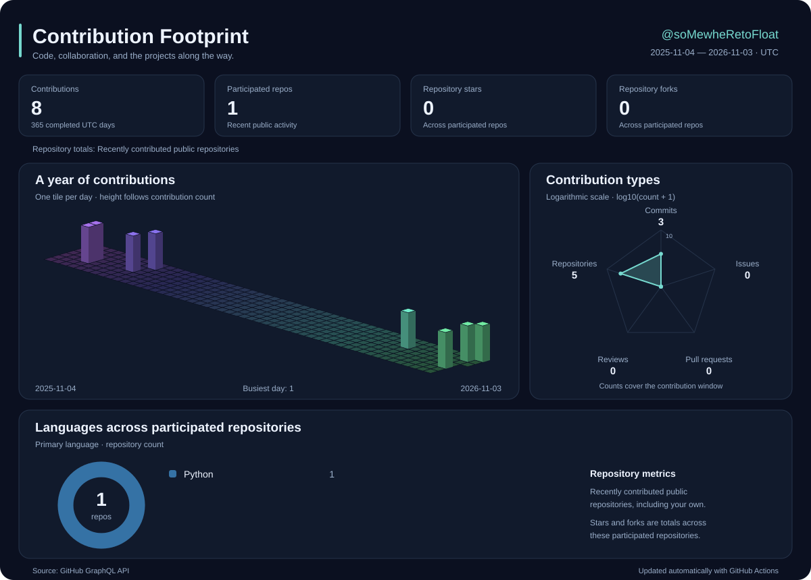

# Zihang Zhan · Fl0at9973

Hi there 👋 · 你好呀 🌩🐒🦆 · Здравствуйте 🍞 · こんにちは！🐕

Computer Science and Technology · Embodied Intelligence

  <a href="https://github.com/soMewheRetoFloat">GitHub</a> ·
  <a href="mailto:zihangzhan2003@gmail.com">Email</a>

### 👋 About Me

- 🎓 I earned my B.E. at Tsinghua University and am pursuing my M.E. there.
- 💻 My major is Computer Science and Technology.
- 🧐 My research focuses on Embodied Intelligence.

### 🧰 Skills

**Basic**

**AI Coding**

**Software Engineering**

**Game Development**

**Others**

### 📈 Contribution Footprint

  

  Contributions cover the last 365 completed UTC days. 
  Repository totals, stars, forks, and language counts describe recently contributed public repositories.

### ✉️ Contact

